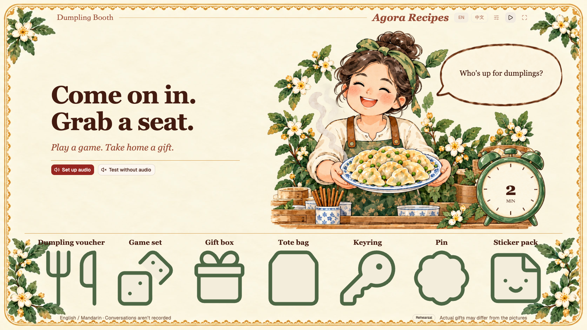
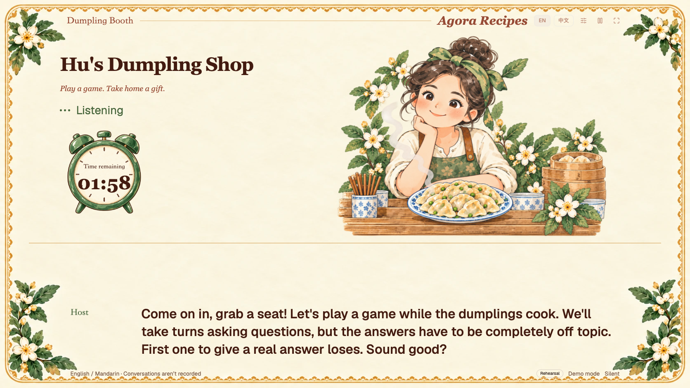
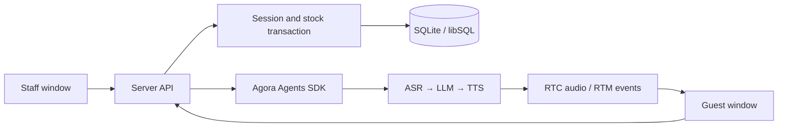

# Build a voice AI dumpling booth

[English](RECIPE.md) · [简体中文](RECIPE.zh-CN.md)

Turn a laptop and a TV into a small dumpling shop. A visitor meets Hu Jiaoman, plays a quick conversation game, and receives a gift. You control the session from the laptop while the TV shows the host, captions, and gift reveal.

This recipe uses TypeScript, TanStack Start, React, shadcn, the Agora Agents SDK, and SQLite. You can rehearse the complete interface locally before connecting voice services.



## 1. Run the booth without credentials

Install Node 24+ and pnpm 12.14.0, then:

```sh
git clone https://github.com/shczhen/recipe-dumpling-booth.git
cd recipe-dumpling-booth
pnpm install --frozen-lockfile
cp .env.example .env.local
pnpm dev
```

Open `/admin` and `/` at `http://127.0.0.1:3000` in two windows of the same browser profile. Staff controls live on `/admin`; the guest window goes on the TV or second monitor. Keep the host, port, and browser profile the same for device preparation and local preference synchronization.

Choose **Test without audio** on the guest screen. On the staff screen, use **Rehearsal** inventory, **Demo mode**, and any game. Start a session and type a guest line from the staff controls. The local driver produces scripted replies, not AI gameplay. It exercises captions, the timer, gift announcements, and the next-guest flow without external services.

The first greeting starts the clock. In the default 120-second session, the application enters the gift announcement at about 90 seconds. After revealing the result, it leaves up to 20 seconds for a reaction, then says goodbye. Staff can prepare the next guest when the visit ends.



[More interface screenshots](../assets/README.md)

## 2. Connect the voice services

Use your own Agora project with Conversational AI enabled. Add the following to `.env.local`:

```dotenv
AGORA_ENABLED=true
AGORA_APP_ID=your-project-id
AGORA_APP_CERTIFICATE=your-project-certificate
AGORA_AREA=AP
AGORA_VOICE_ID=Arrogant_Miss
```

Restart after changing environment variables. Keep credentials server-side. The application mints short-lived RTC/RTM access tokens for the browser; the project certificate is never a browser setting.

The server gateway in `src/server/agora.ts` builds the agent with `agora-agents`:

```text
AresSTT → OpenAI-compatible LLM → MiniMaxTTS
```

The included setup uses MiniMax `speech_2_6_turbo` and the `Arrogant_Miss` voice preset. Check that your project and region can use the selected services. To bring your own LLM, configure all three fields:

```dotenv
LLM_BASE_URL=https://api.openai.com/v1/chat/completions
LLM_API_KEY=your-own-key
LLM_MODEL=your-accessible-model
```

`LLM_BASE_URL` is the complete Chat Completions endpoint. Choose an accessible model rather than copying an account-specific alias. `LLM_REASONING_EFFORT` is optional and should only be set if that model supports it. Leave all three LLM fields blank to use the SDK's default provider path; your project still needs the relevant service entitlement. `TTS_API_KEY` is optional when your project needs a separate MiniMax credential.

On the guest screen, choose input and output devices. Record a short microphone test, replay it, and confirm you heard it. The recording stays in the browser and is discarded. An empty device list, silent recording, failed decode, or failed playback does not count as ready. Output selection depends on browser support; use the system audio settings if the browser cannot choose a sink.

Select **Live voice** on the staff screen. For a public network origin, microphone access needs HTTPS; localhost is supported for local use. A close microphone and speaker placement that avoids feedback make a large difference at a booth.

## 3. Give the host a game

The host's character is in `src/server/prompts/host.ts`. Each game's bilingual rules and greeting are in `src/server/prompts/games.ts`. The staff picker reads names and hints from `src/shared/games.ts`.

| Game               | What the guest does                                               |
| ------------------ | ----------------------------------------------------------------- |
| Twenty questions   | Ask yes-or-no questions to guess the host's object, or swap roles |
| Describe and guess | Describe an object without saying its name                        |
| Food chain         | Alternate naming foods without repeats; no last-letter rule       |
| Story chain        | Add one sentence to a shared story                                |
| Wrong answers      | Answer off topic; a normal answer loses the round                 |

Read [the game guide](../games.md) for rules, ways to adapt them, and illustrative dialogue. There is also a [Chinese guide](../games.zh-CN.md).

Keep rules short. Let the host make mistakes, acknowledge a loss, and play again. There is no per-utterance scoring model or structured game board. The application selects and saves one game at Start; repeated requests reuse the same session. A small game round ending does not end the visit or allocate another gift.

## 4. Separate conversation from reliable actions



`src/server/service.ts` owns the clock, status transitions, result, and inventory. `src/server/agora.ts` owns the provider configuration and agent lifecycle. `src/voice/agora-client.ts` owns browser media routing, transcript events, controlled announcements, and teardown.

The server saves a gift at three quarters of the session duration. The browser stops ordinary playback and input immediately, then requests the saved gift line with interrupt semantics. A reveal waits for evidence that the matching announcement completed: transcript metadata, received media timestamps, and a quiet interval. The goodbye uses the same playback discipline. Wall-clock time alone is not proof that audio reached the speakers.

After the reveal, the host can chat for up to 20 seconds within the session deadline. If a guest explicitly leaves, the application allocates the participation gift early and uses a closing line with a goodbye. If a started session is interrupted, its saved result remains available for staff. A connection that never reaches the opening does not consume stock.

## 5. Keep captions and character states responsive

Incremental transcripts are filtered locally and displayed immediately. Each utterance updates in place; recent completed lines move into smaller history above it. Length limits, wrapping, and a reserved caption area keep long turns from pushing the character off-screen.

Completed guest utterances handle language, leave, and moderation actions asynchronously. Ordered user turns prevent a slow HTTP response from reverting a newer language choice. No transcript history is persisted by the application; your cloud providers have their own data policies.

The host switches among welcome, listening, thinking, speaking, gifting, and paused poses. Idle invitations rotate as text bubbles with gentle motion. They do not play idle audio. Reduced-motion preferences disable decorative animation.

English is the default interface language. A switch enables Simplified Chinese and synchronizes the preference between same-origin windows. The session's spoken language is separate: the host follows the guest, and captions retain the actual speech rather than translating it.

## 6. Configure gifts and recover inventory

The fresh sample catalog contains seven generic prizes and four batches totaling 500 units. `scripts/catalog.json` supplies defaults; the database becomes authoritative after initialization. Staff can edit bilingual names, available quantities, and unopened batches between sessions, with an operation reason. Open the next batch when needed.

Rehearsal, formal, and online inventory are isolated. Starting and allocating a gift use transactions. The service stores the chosen gift and its names with the session; later edits cannot rewrite a previous result. Retrying, stopping, restarting, or restoring a known result must not draw again.

Use staff checkpoint and JSON export controls before event changes. For a full JSON restore, stop the app and run:

```sh
node scripts/restore.mjs backup.json ./recovered-data
```

Set `DATA_DIR=./recovered-data` and restart. The tool validates inventory totals and refuses to overwrite an existing database. Restore only backups from this standalone recipe, not earlier experimental schemas. [Deployment and recovery](../deployment.md) explains the portable and online paths.

## 7. Replace the theme

Edit `public/dumpling/appearance.json` for image slots and bilingual idle invitations. The host artwork is approved for inclusion; original event prize images have been replaced with generic Lucide icons. Replace gift images independently from names and quantities. Keep seven image slots in catalog order.

Use same-origin paths under `public/`. Invalid configuration falls back to bundled defaults. [Customization](../customization.md) lists the slots and boundaries; [asset provenance](../ASSETS.md) and [third-party notices](../../THIRD_PARTY_NOTICES.md) record licenses.

## 8. Package and verify

```sh
pnpm verify
pnpm exec playwright install chromium
pnpm test:ui
pnpm package:portable
```

Build first. A native Windows or macOS portable package includes the application, Node runtime, and SQLite, plus a blank credential template. Existing data and real keys are excluded. Live voice still requires network access. Vercel with a separate remote libSQL database and distinct staff/guest passcodes is optional; see [deployment](../deployment.md).

Automated tests exercise HTTP behavior, SQLite allocation and recovery, SDK request generation, synthetic media timing, device failures, localization, and browser flows. They do not call live voice services. Validate the actual microphone, TV output, service access, and consecutive guests before an event.

Check the [release checklist](../release-checklist.md) for licensing and hardware acceptance status. A local scripted rehearsal does not replace a live test with the service accounts and equipment you plan to use.
