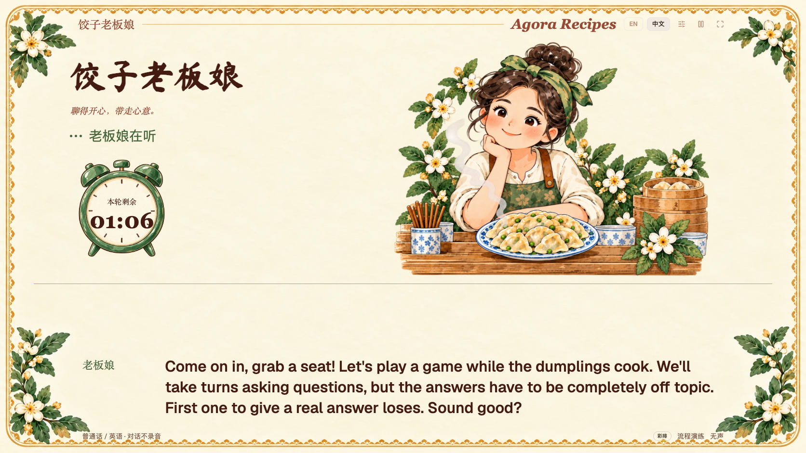
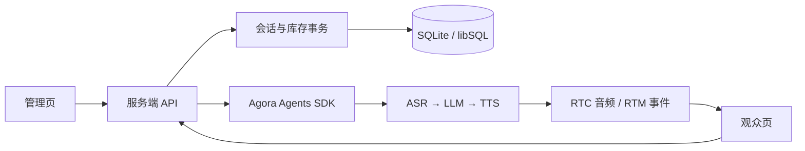

# 搭建一个能陪观众聊天玩游戏的 AI 饺子铺

[English](RECIPE.md) · [简体中文](RECIPE.zh-CN.md)

一台电脑加一台电视，就能搭起一个小饺子铺。观众和老板娘胡饺蛮玩个对话小游戏，聊上几句，再领一份小礼品。工作人员在电脑上控制开局，电视展示老板娘、实时字幕和礼品揭晓。

本 Recipe 使用 TypeScript、TanStack Start、React、shadcn、Agora Agents SDK 和 SQLite。可以先在本地跑通整套界面，再接入实时语音服务。Demo 默认英文，支持切换简体中文。


## 1. 不用密钥，先在本地演练

安装 Node.js 24 及以上版本和 pnpm 12.14.0，然后执行：

```sh
git clone https://github.com/shczhen/recipe-dumpling-booth.git
cd recipe-dumpling-booth
pnpm install --frozen-lockfile
cp .env.example .env.local
pnpm dev
```

用同一浏览器的同一用户配置打开两个窗口：`http://127.0.0.1:3000/admin` 是管理页，`http://127.0.0.1:3000/` 是观众页。把观众页拖到电视或扩展屏。两页的域名、端口和浏览器用户配置应保持一致，设备准备状态和界面偏好才能同步。

界面默认英文，可以在右上角切换为简体中文。观众页选择“无声演练”；管理页使用“彩排”库存和“流程演练”，选择任意玩法后启动一局。工作人员可以从管理页输入观众台词。此时程序使用固定回复，供你检查字幕、计时、送礼和下一位观众的流程；要和 AI 真正玩游戏，需要接通实时语音。

开场播放时开始计时。默认一局 120 秒，约第 90 秒进入送礼播报。礼品揭晓后，老板娘最多再聊 20 秒，然后告别。本局结束后，工作人员可以准备接待下一位。



[查看更多界面截图](../assets/README.md)

## 2. 接通实时语音

在自己的 Agora 项目中启用 Conversational AI，然后把以下配置填入 `.env.local`。示例值都是占位符，应替换为自己的配置：

```dotenv
AGORA_ENABLED=true
AGORA_APP_ID=your-project-id
AGORA_APP_CERTIFICATE=your-project-certificate
AGORA_AREA=AP
AGORA_VOICE_ID=Arrogant_Miss
```

修改环境变量后需要重启。密钥保留在服务端；应用为浏览器签发短期 RTC 和 RTM Token，项目证书不会作为浏览器配置下发。

服务端网关位于 `src/server/agora.ts`，通过 `agora-agents` 创建以下语音链路：

```text
AresSTT → OpenAI 兼容 LLM → MiniMaxTTS
```

内置配置使用 MiniMax `speech_2_6_turbo` 和 `Arrogant_Miss` 音色。请确认自己的 Agora 项目和区域支持这些服务。自带 LLM 时，需要同时填写三项：

```dotenv
LLM_BASE_URL=https://api.openai.com/v1/chat/completions
LLM_API_KEY=your-own-key
LLM_MODEL=your-accessible-model
```

`LLM_BASE_URL` 应是完整的 Chat Completions 接口地址。模型填写自己账号实际可用的名称；只有模型支持时才设置可选的 `LLM_REASONING_EFFORT`。三项 LLM 配置都留空时，使用 SDK 的默认服务路径，项目仍需开通对应服务权限。如果项目需要单独提供 MiniMax 凭据，可以填写 `TTS_API_KEY`。

在观众页选择输入和输出设备，录一小段麦克风测试，再回放并确认听到了声音。录音只临时保留在浏览器内，随后丢弃。空设备列表、无声录音、解码失败或播放失败都不会算作设备就绪。浏览器不支持选择输出设备时，请在操作系统的声音设置中选择扬声器。

准备完成后，在管理页选择“真实语音”。公网地址需要 HTTPS 才能使用麦克风；本地可以使用 localhost。现场建议使用近讲话筒，并调整外放位置，避免回声和啸叫。

## 3. 给老板娘安排一个小游戏

人物设定位于 `src/server/prompts/host.ts`。各玩法的中英文规则和开场白位于 `src/server/prompts/games.ts`；管理页的玩法名称和提示来自 `src/shared/games.ts`。

| 玩法         | 观众怎么玩                                   |
| ------------ | -------------------------------------------- |
| 二十问       | 用是非问题猜老板娘心里的东西，也可以交换角色 |
| 你描述她来猜 | 描述一个东西，但不直接说出它的名字           |
| 食物接龙     | 轮流报食物名，不能重复；不用按末字接龙       |
| 故事接龙     | 一人一句，把同一个故事接下去                 |
| 答非所问     | 故意回答不相干的话，正常回答就输掉这一小局   |

[玩法指南](../games.zh-CN.md)包含规则、改编方法和示意对话，也提供[英文版](../games.md)。示意对话用来说明玩法，不是真实通话记录。

规则保持简短，允许老板娘猜错、认输和再来一局。程序没有逐句判分模型或结构化游戏棋盘。开局时选定并保存一个玩法；重复的启动请求复用同一会话。一个小游戏结束后，可以接着聊或再玩，整场接待不会因此结束，也不会多发一份礼品。每位开聊的观众都有礼品，输赢不影响抽取结果。

## 4. 让程序负责计时、送礼和库存



`src/server/service.ts` 负责计时、状态流转、礼品结果和库存；`src/server/agora.ts` 负责语音服务配置和 Agent 生命周期；`src/voice/agora-client.ts` 负责浏览器的设备路由、字幕事件、受控播报和资源释放。

到一局时长的四分之三处，服务端保存礼品结果。浏览器立即停止普通对话的播放和输入，再用打断语义请求播报已保存的礼品台词。揭晓前需要确认对应播报已完成：检查字幕元数据、收到的媒体时间戳，以及一段安静间隔。告别也采用相同机制。仅仅等够一段时间，不能证明扬声器已经播完。

揭晓后，老板娘可以在本局截止前继续聊，最多 20 秒。如果观众明确表示要离开，程序会提前分配参与礼，并使用包含告别的收尾台词。已经开始的接待即使中断，保存的结果仍可供工作人员恢复查看；连接尚未进入开场的会话不消耗库存。

## 5. 处理字幕、人物状态和中英文

增量字幕在本地过滤后立即显示。同一句话持续更新，最近说完的几条缩小后移到上方。长度限制、自动换行和预留的字幕区域可以防止长台词把人物挤出画面。

观众一句话说完后，程序异步处理语言切换、离开和内容审核动作。观众轮次按顺序处理，较慢的 HTTP 响应不会覆盖较新的语言选择。应用不持久化保存对话字幕；云端服务另有各自的数据政策。

老板娘会切换迎客、听、想、说、送礼和暂停等姿态。待机时轮换招呼气泡，配合轻微动作；待机气泡不播放声音。开启系统“减少动态效果”偏好后，装饰动画会停用。

**界面默认英文**，切换为简体中文后，偏好会在同源窗口间同步。界面语言与对话语言分开管理：老板娘跟随观众的语言回应，字幕显示实际说出的话，不自动翻译。

## 6. 配置礼品和恢复库存

全新示例包含七种通用礼品，分四批，共 500 份。`scripts/catalog.json` 提供初始化默认值，初始化后的数据库才是实际库存来源。局间可在管理页修改中英文名称、数量和未开放的批次，并填写操作原因；需要时再开放下一批。

彩排、正式和线上库存彼此隔离。启动和分配礼品使用事务；程序会把选中的礼品及当时的名称一起保存到会话中，后续改名不会影响已保存的结果。重试、停止、重启或恢复已有结果，都不能重新抽取。

现场调整前，先使用管理页的检查点和 JSON 导出功能备份。需要完整恢复 JSON 备份时，停止应用并执行：

```sh
node scripts/restore.mjs backup.json ./recovered-data
```

设置 `DATA_DIR=./recovered-data` 后重启。工具会校验库存总量，并拒绝覆盖已有数据库。只恢复本独立 Recipe 导出的备份，早期实验版本的数据结构不适用。[部署与恢复说明](../deployment.md)介绍了便携包和线上部署方式。

## 7. 换人物、素材和招呼语

修改 `public/dumpling/appearance.json`，即可更换各图片槽位及中英文待机招呼语。老板娘插画已获得仓库所有者同意，可随项目公开分发；原活动奖品图已替换为通用 Lucide 图标。礼品图片与名称、数量分开配置，七个图片槽位按礼品目录顺序对应。

素材使用 `public/` 下的同源路径。配置无效时会回退到内置默认值。[定制说明](../customization.md)列出可替换的槽位和边界；[素材来源](../ASSETS.md)与[第三方声明](../../THIRD_PARTY_NOTICES.md)记录相关许可。

项目采用 [Apache License 2.0](../../LICENSE)。第三方图标、字体和组件保留各自许可；替换素材时，也要确认新素材可以公开分发。

## 8. 验证和打包交付

```sh
pnpm verify
pnpm exec playwright install chromium
pnpm test:ui
pnpm package:portable
```

先构建，再打便携包。Windows 和 macOS 各自的原生便携包包含应用、Node 运行时、SQLite 和空白凭据模板，不携带已有数据或真实密钥。实时语音仍然需要联网。也可以部署到 Vercel，使用独立的远程 libSQL 数据库，并分别设置管理和体验口令，详见[部署说明](../deployment.md)。

自动化测试覆盖 HTTP 行为、SQLite 分配与恢复、SDK 请求生成、合成媒体时序、设备异常、多语言和浏览器流程，不调用真实语音服务。活动前仍需用实际麦克风、电视输出和服务账号，测试连续接待多位观众。

[发布清单](../release-checklist.md)列出了许可和现场验收事项。本地固定回复演练，不能代替使用实际账号与设备进行的实时通话测试。
